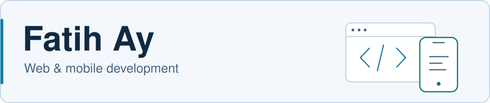

<picture>
  <source media="(prefers-color-scheme: dark)" srcset="assets/profile-header-dark.svg">
  <source media="(prefers-color-scheme: light)" srcset="assets/profile-header-light.svg">
  
</picture>

<h3 align="center">Full Stack Developer · Stuttgart, Germany</h3>

  
  

I build **web and mobile applications**, from the interface to the API.
My current focus is **proPod** and **Nebula at Hyfindr**, alongside contributions to **Expo**.

##  What I'm building

###  proPod

A mobile application for **iOS and Android**, currently in development.

- **Mobile:** React Native and Expo
- **Backend:** Python and FastAPI
- **Release:** Public release planned; source code is private

###  Hyfindr · Nebula

My main project at **Hyfindr**, where I develop the company's web platform.

- **Backend:** PHP, Symfony and Sylius
- **Web:** Application features and frontend development

##  Open source

### Expo · Android audio playback

An `expo-audio` playlist crashed on Android when advancing to a newly added track
with lock-screen controls active.

- **Investigation:** Traced the crash to player events not reaching the Android media session.
- **Contribution:** Created a minimal reproduction and submitted a proposed fix.
- **Code:** [Pull request #52193](https://github.com/expo/expo/pull/52193) · [Reproduction & steps](https://github.com/iamfatihay/expo-audio-lockscreen-playlist-crash)

##  Technologies

| Area | Technologies |
| --- | --- |
| **Web** |     |
| **Mobile** |   |
| **Backend** |      |
| **Data & search** |    |
| **Tools** |    |

---

  

